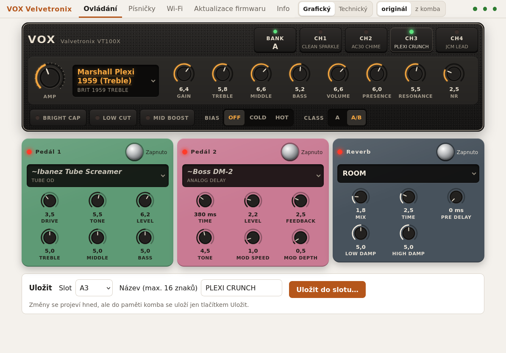
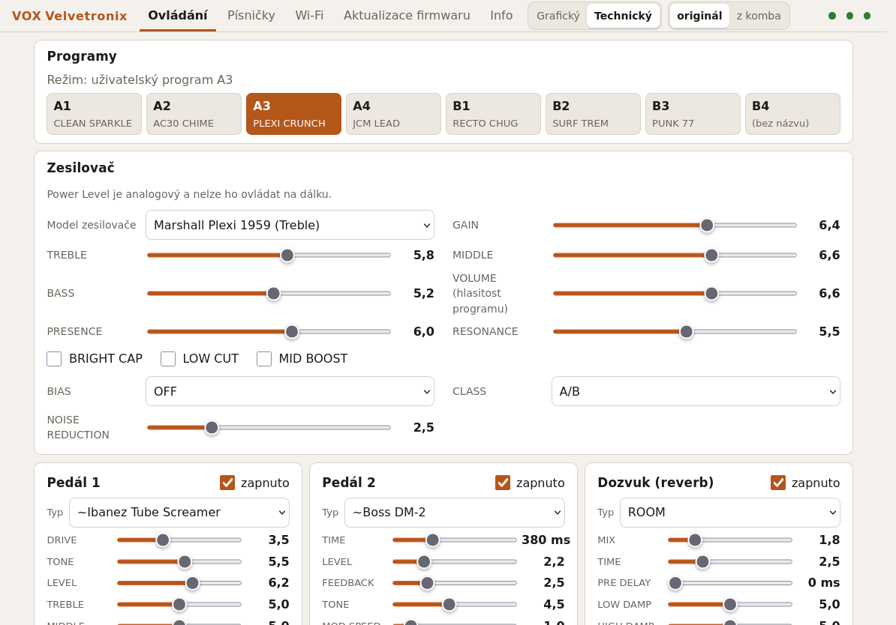

# pi-velvetronix

Dálkové ovládání komba **VOX Valvetronix VT100X** (řada VT-X) z tabletu, telefonu nebo počítače
přes Wi-Fi. Malé Raspberry Pi Zero 2 W je USB kabelem připojené ke kombu, vytváří českou webovou
aplikaci a posílá kombu příkazy přes USB-MIDI. Funguje v lokální síti bez internetu a bez
aplikace VOX Tone Room.



## Co umí

- **Panel komba na obrazovce.** Model zesilovače, otočné knoby (GAIN, TREBLE, MIDDLE, BASS,
  VOLUME, PRESENCE, RESONANCE, NOISE REDUCTION), přepínače BRIGHT CAP, LOW CUT, MID BOOST, BIAS
  a CLASS, banky a kanály A1–B4. Pedály vypadají jako krabičky s nožním spínačem v barvě
  napodobovaného pedálu.
- **Dva režimy.** **Grafický** (panel jako na kombu) a **Technický** (posuvníky a seznamy).
  Přepínač názvů **originál / z komba**, např. „Marshall JCM800“ místo „BRIT 800“. Předlohy
  pedálů a některých zesilovačů VOX oficiálně neuvádí: nejisté názvy jsou označené „~“
  a podtržené, zdroje jsou ve `web/research/`.
- **Písničky.** 41 přibližných zvuků slavných písniček, hlavně punk (punk, pop-punk, skate-punk,
  hardcore, ska-punk, český punk) a rockové klasiky, např. Seven Nation Army. **Zahrát** nastaví
  zvuk v kombu jen živě, nemění hlasitost programu a nic neukládá.
- **Ukládání do kanálů.** Zvuk jde uložit pod vlastním jménem (max. 16 znaků) do A1–B4. Kombo
  zápis potvrdí a aplikace ho ověří zpětným přečtením.
- **Víc ovladačů najednou, všechno živě.** Kombo může současně ovládat až 8 oken: tablet,
  telefon, další záložka nebo MCP server pro Clauda (`mcp/`). Každé okno hned vidí, co změnila
  ostatní, i co se otočí přímo na kombu.
- **Aplikace na ploše iPadu.** V Safari Sdílet → Přidat na plochu: vlastní ikona, celá obrazovka
  bez lišt Safari (viz [Instalace na plochu](#instalace-na-plochu-ipadu-nebo-telefonu)).
- **Rozložení pro tablet a telefon.** Na iPadu 11" se celý panel s pedály vejde na jednu obrazovku
  na šířku i na výšku. Na telefonu je krátká hlavička (název, tečky stavu, záložky) a pedály se
  přepínají záložkami Pedál 1 / Pedál 2 / Reverb, které ukazují i zapnutí a typ efektu.
- **Bez zásahu do paměti komba, dokud to nechceš.** Pi nepustí zápis do paměti komba (`4C`, `11`),
  pokud zpráva není označená jako výslovné uložení. Start, připojení ani aktualizace nic
  nepřepisují.
- Wi-Fi nastavení, záložní hotspot `VOX-Velvetronix`, aktualizace firmwaru přes web s návratem
  na předchozí verzi, když nová nenaběhne.

Power Level je na kombu analogový a dálkově ovládat nejde.

| Technický režim | Písničky |
|---|---|
|  |  |

| iPad na výšku | Telefon |
|---|---|
|  |  |

Obrázky jsou z náhledu se simulovaným kombem (`cd web && npm run preview`).

## Jak to funguje

```
tablet / telefon / Claude ──Wi-Fi── Pi Zero 2 W ──USB (OTG)── VOX VT100X
  web + protokol VOX             Go daemon:                  zvuk, programy
  (TypeScript), MCP server       WebSocket ↔ ALSA rawmidi
                                 fronta povelů, rozesílání,
                                 přihlášení, Wi-Fi, mDNS,
                                 aktualizace s rollbackem
```

- Protokol VOXu běží v prohlížeči (`web/src/protocol/`), stejný kód používá MCP server. Pi předává
  celé SysEx zprávy a kontroluje je.
- Každé okno je s Pi spojené přes WebSocket `/ws`. Daemon povely od všech oken posílá kombu po
  jednom a odpověď vrátí odesílateli. Kombo totiž odpovídá jen „OK“ a neříká komu. Změnu, kterou
  kombo potvrdí, daemon rozešle ostatním oknům. Změny z knobů na kombu dostanou všechna okna.
- Podklady: protokol [docs/protocol.md](docs/protocol.md) (z oficiální „Valvetronix X MIDI
  Implementation v1.0“ a projektu [vox-amp-librarian](https://github.com/tmarsteel/vox-amp-librarian),
  MIT licence, Copyright (c) 2023 Tobias Marstaller), návrh a rozhraní [docs/design.md](docs/design.md),
  záznam testů [docs/testing.md](docs/testing.md).

## Instalace na plochu iPadu nebo telefonu

1. Otevři v Safari `http://velvetronix.local` a přihlas se.
2. Klepni na **Sdílet** → **Přidat na plochu** → **Přidat**.
3. Na ploše se objeví ikona **VOX**. Otevře aplikaci přes celou obrazovku.

Aplikace na ploše má vlastní přihlášení, odděleně od Safari, takže se v ní přihlas jednou znovu.
Přihlášení vydrží 30 dní. Bez spojení s Pi aplikace nefunguje: web běží přes HTTP v lokální síti,
a v takovém prostředí prohlížeče nedovolí offline režim (service worker).

## MCP server pro Clauda

`mcp/` obsahuje MCP server, přes který může Claude kombo číst a nastavovat: stav, živé nastavení
zvuku, písničky, přepnutí a uložení programu. Otevřené stránky vidí jeho změny živě. Sestavení
a registrace jsou v [mcp/README.md](mcp/README.md).

## Hardware a zapojení

| Díl | Poznámka |
|---|---|
| Raspberry Pi Zero 2 W | ověřeno: `Raspberry Pi Zero 2 W Rev 1.0`, Raspberry Pi OS Lite 64-bit (Debian 13 trixie), kernel 6.18 |
| Zdroj 5,1 V / 2,5 A s micro-USB | oficiální Raspberry Pi zdroj (např. Alza `RKpi3na125`). Do portu **PWR IN** |
| OTG adaptér micro-USB (samec) → USB-A (samice) | např. Alza `ugre27`, oficiální „Raspberry Pi Zero USB adapter“ |
| Kabel USB-A → konektor komba | VT100X má podle japonského manuálu, nákresu panelu a webu VOX zásuvku **USB mini-B** (anglický manuál píše „Type B“). **Před nákupem zkontroluj zásuvku na horním panelu.** Krátký (0,5-1 m), stíněný |

Porty na Pi Zero 2 W (při pohledu na desku, mini-HDMI vlevo):

- **USB** (prostřední micro-USB, blíž k mini-HDMI) = data, host pro kombo. Sem OTG adaptér.
- **PWR IN** (krajní micro-USB v rohu) = jen napájení. Sem zdroj.

```
zdroj 5 V ──micro-USB──> [PWR IN]  Pi Zero 2 W  [USB] ──OTG adaptér──> USB-A ──kabel──> VOX (mini-B)
```

Napájení a VBUS:

- Pi napájí **vždy samostatný zdroj**. Kombo Pi nenapájí a napájet nemá.
- V host režimu Pi posílá na VBUS datového portu 5 V ze své napájecí větve (bez spínače
  a pojistky; oficiální schéma to nekreslí, potvrzují to měření komunity). Kombo je napájené
  ze sítě a z USB prakticky nic neodebírá.
- Zpětné napájení: USB zařízení nesmí VBUS budit. Jednou to můžeš ověřit multimetrem: kombo
  zapnuté, Pi odpojené, mezi VBUS a GND na kabelu od komba má být ~0 V.
- Nepřipojuj datový port Pi k počítači, když je zároveň zapojený zdroj v PWR IN (dva 5V zdroje
  proti sobě).
- Výchozí USB ovladač `dwc_otg` přepne do host režimu podle ID pinu OTG adaptéru. Kdyby
  kabel ID pin neuzemnil, přidej do `/boot/firmware/config.txt` řádek
  `dtoverlay=dwc2,dr_mode=host` a restartuj.

Brum: kombo je přístroj třídy I (ochranné uzemnění). USB kabel spojí zem Pi se zemí komba.
Pomáhá krátký stíněný kabel, kvalitní zdroj ve stejné rozbočovací zásuvce jako kombo, feritový
kroužek u komba. Pi a anténu drž dál od INPUT jacku a kytarového kabelu.

## Umístění

Kombo VT100X má uzavřenou basreflexovou skříň, elektroniku (síťový zdroj, DSP, 100W
koncový stupeň, elektronka) v horním šasi s větracími otvory v zadním plechu a USB zásuvku
na horním panelu.

- **Doporučení: Pi v malé větrané plastové krabičce na vnější zadní nebo boční stěně skříně**,
  ve spodní polovině, připevněné odnímatelným suchým zipem (bez šroubů do skříně). Kov
  krabičky by tlumil Wi-Fi.
- Nejméně ~10 cm od zadního plechu šasi a jeho větracích otvorů; nic na otvory neopírej.
- Kabel k horní USB zásuvce veď přes horní zadní hranu, mimo INPUT jack a síťový kabel.
  Micro-USB konektor u Pi odlehči (úhlový konektor, příchytka), skříň vibruje.
- Uvnitř skříně jen tehdy, když jde zadní stěna sundat šrouby, a jen v reproduktorovém
  prostoru, na dno nebo spodní boční stěnu, dál od šasi, reproduktoru, magnetu a basreflexového
  otvoru, na pěnových podložkách proti drnčení. Kombo předtím odpoj ze sítě. Průchod kabelů
  vyžaduje otvor s průchodkou (zásah do skříně, riziko záruky). Před zavřením ověř signál Wi-Fi.
- **Nikdy nezasahuj do síťové, elektronkové ani zesilovací části a nenapájej Pi z vnitřního
  zdroje komba.** Takovou změnu musí posoudit servis podle schématu.
- Pi Zero 2 W škrtí výkon od 80 °C. Na otevřeném vzduchu běží kolem 43 °C. Teplotu zjistíš
  `vcgencmd measure_temp`.

## Adresy a přístupové údaje

| Co | Hodnota |
|---|---|
| Web (domácí síť) | `http://velvetronix.local/`, `http://vox.local/`, nebo IP adresa (zobrazuje se v hlavičce webu) |
| Web (hotspot) | Wi-Fi `VOX-Velvetronix`, pak `http://10.42.0.1/` |
| Heslo do webu | `WEB_PASSWORD` v `secrets/velvetronix.env` na Macu (vygenerováno instalátorem, mimo Git) |
| Heslo hotspotu | `AP_PSK` ve stejném souboru |
| SSH | `ssh velvetronix@velvetronix.local` (klíč z Macu) |

Pi Zero 2 W umí jen **2,4 GHz** Wi-Fi.

## Sestavení

Na Macu (Apple Silicon), potřeba: Go (verzi 1.26.9 si stáhne samo podle `go.mod`), Node 24,
npm. Závislosti jsou připnuté v `go.mod`/`go.sum` a `web/package-lock.json`.

```sh
scripts/test.sh                    # web testy + build, go vet, go test, cross build
scripts/build.sh                   # web -> internal/web/dist/index.html.gz, Go -> dist/ (linux/arm64, statické)
scripts/release.sh                 # dist/*.tar.gz, deterministické
scripts/test-deploy.sh             # testy instalačních skriptů v Debian kontejneru (docker)
(cd web && npm run preview)        # náhled UI v prohlížeči se simulovaným kombem (bez hardwaru)
```

Verze je v souboru `VERSION` (nebo proměnná `VERSION=0.2.0`). Výstupy:

| Soubor | Použití |
|---|---|
| `dist/pi-velvetronix-<ver>-linux-arm64.tar.gz` | **aktualizace přes web** (jen `manifest.json` + binárka) |
| `dist/pi-velvetronix-install-<ver>.tar.gz` | **první instalace / reinstalace přes SSH** (binárka, systemd jednotky, root skripty, polkit) |

## První instalace

1. Raspberry Pi Imager: Raspberry Pi OS Lite (64-bit), hostname `velvetronix`, uživatel
   `velvetronix`, Wi-Fi domácí sítě (2,4 GHz), země CZ, SSH zapnuté. Vlož kartu a zapni Pi.
2. Na Macu jednou nahraj SSH klíč: `ssh-copy-id velvetronix@velvetronix.local`.
3. `scripts/install.sh` (výchozí cíl `velvetronix@velvetronix.local`). Skript:
   - vygeneruje `secrets/velvetronix.env` (pokud chybí; práva 600, mimo Git),
   - sestaví a zabalí release, nakopíruje ho na Pi a jako root spustí `deploy/install-remote.sh`,
   - tajemství posílá jen přes stdin SSH, nikdy na příkazové řádce ani do logu,
   - vytvoří systémového uživatele `pi-velvetronix`, systemd jednotky, polkit pravidlo,
     hotspot `vox-ap`, zram swap, vypne PipeWire (bezhlavé zařízení, mohl by zabrat MIDI port).
4. Otevři `http://velvetronix.local/` a přihlas se heslem `WEB_PASSWORD`.

Instalaci jde kdykoli zopakovat (je idempotentní); zachová Wi-Fi sítě i tajemství.

## Wi-Fi

- Pi se připojuje do uložených domácích sítí (NetworkManager, opakuje se donekonečna).
- Když domácí síť není dostupná víc než 90 s, spustí se hotspot `VOX-Velvetronix`
  (WPA2, `10.42.0.1`). V režimu hotspotu Pi pravidelně hledá uložené sítě a vrátí se, jakmile
  některou uvidí a nikdo hotspot 5 minut nepoužívá.
- Stránka **Wi-Fi**: seznam sítí, připojení k nové síti (SSID + heslo), zapomenutí uložené sítě,
  ruční spuštění hotspotu na N minut.
- Neúspěšné připojení nikdy nemaže uloženou konfiguraci. Mazat jde jen tlačítkem Zapomenout.

## Aktualizace firmwaru (přes web)

1. `VERSION=0.2.0 scripts/build.sh && VERSION=0.2.0 scripts/release.sh`
2. Web → **Aktualizace firmwaru** → vyber `dist/pi-velvetronix-0.2.0-linux-arm64.tar.gz` → Nahrát.
   (Nebo z Macu `scripts/dev-update.sh velvetronix.local dist/...tar.gz`.)
3. Daemon balík zkontroluje (gzip, tar se dvěma soubory, název, architektura `linux/arm64`,
   verze, sha256, ELF aarch64, velikost max. 40 MiB) a odmítne cokoli jiného, např. obraz SD
   karty (`.img`, `.xz`), zip, holou binárku nebo balík pro jinou architekturu.
4. Během instalace se pozastaví ovládací příkazy. Root updater balík znovu ověří, nainstaluje
   do `/opt/pi-velvetronix/releases/<ver>/`, atomicky přepne symlink `current` a restartuje
   službu. Web ukáže průběh a výsledek a sám se znovu připojí.
5. Nová verze se potvrdí až po vlastní kontrole (HTTP na `127.0.0.1`), nezávisle na kombu
   i domácí Wi-Fi. Když se třikrát nepotvrdí (pád, zaseknutí, timeout 60 s), `boot-guard`
   vrátí předchozí verzi. Výsledek je vidět na stránce aktualizace.

Web aktualizuje jen aplikaci (a s ní i web, který je v binárce). Systemd jednotky, root skripty
a polkit se mění jen `scripts/install.sh`. Každá nová verze musí zůstat kompatibilní
s nainstalovanými root skripty, jinak ji nasaď přes `scripts/install.sh`.

## Obnova

| Situace | Postup |
|---|---|
| Web nefunguje, SSH ano | `scripts/install.sh` znovu nainstaluje aktuální verzi |
| Nedostupná domácí síť | připoj se k hotspotu `VOX-Velvetronix`, `http://10.42.0.1/`, nastav Wi-Fi |
| Nic nefunguje | vyndej microSD kartu, nahraj systém Raspberry Pi Imagerem znovu a proveď „První instalace“. Pi Zero nemá tlačítka BOOT/RESET; obnova je vždy přes SD kartu |
| Zapomenuté heslo webu | `scripts/install.sh` znovu nastaví heslo ze `secrets/velvetronix.env` (nebo smaž soubor a vygeneruje se nové) |

Logy: `ssh velvetronix@velvetronix.local sudo journalctl -u pi-velvetronix -u pi-velvetronix-updater -b`.
Hesla, PSK ani session tokeny se nikdy nelogují.

## Test s kombem

Kombo VT100X je ověřené (viz [docs/testing.md](docs/testing.md)). Postup, kdyby ho Pi nenašlo:

1. Zapoj Pi podle schématu výše, zapni kombo.
2. Web: hlavička má ukázat **Kombo (USB) připojeno** (až po odpovědi komba na Device Inquiry).
   Bez komba ukazuje „odpojeno“.
3. Kontrola na Pi (služba drží MIDI port výhradně, proto ji na chvíli zastav):

   ```sh
   ssh velvetronix@velvetronix.local
   lsusb                                    # čekáme 0944:xxxx (KORG)
   cat /proc/asound/cards; amidi -l         # název "Valvetronix X" nebo podobný
   sudo systemctl stop pi-velvetronix
   amidi -p hw:1,0,0 -S "F0 7E 7F 06 01 F7" -d -t 2        # identita, čekáme ... 42 34 01 ...
   amidi -p hw:1,0,0 -S "F0 42 30 00 01 34 12 F7" -d -t 2  # režim, čekáme F0 42 30 00 01 34 42 ...
   sudo systemctl start pi-velvetronix
   ```

4. Pokud se karta jmenuje jinak a web ukazuje „odpojeno“, pošli výstup `cat /proc/asound/cards`.
   Výběr zařízení řídí parametr `--midi-match` (výchozí `Valvetronix`).

## Omezení

- Se skutečným VT100X je ověřené připojení, ovládání, ukládání do slotu se zpětným přečtením
  a sdílené ovládání z více oken. Přežití uložených programů po vypnutí komba a změny z knobů
  přímo na kombu zatím ověřené nejsou. Viz [docs/testing.md](docs/testing.md).
- Import/export VTXPROG zatím není (zadání: až po spolehlivém základu).
- Web běží přes HTTP v lokální síti; heslo putuje v síti nešifrovaně.
- Polkit pravidlo povoluje NetworkManager akce uživateli `pi-velvetronix` (kontrola podle
  systemd jednotky na polkitd 126 nefunguje).

## Licence

[MIT](LICENSE). Popis protokolu a tabulky vycházejí z oficiální VOX „Valvetronix X MIDI
Implementation v1.0“ a z projektu [vox-amp-librarian](https://github.com/tmarsteel/vox-amp-librarian)
(MIT, Copyright (c) 2023 Tobias Marstaller); kód z něj převzatý není. VOX, Valvetronix a názvy
napodobovaných zesilovačů a efektů jsou ochranné známky svých vlastníků a slouží jen
k identifikaci zvuků. Projekt není spojený s VOX Amplification ani KORG.
