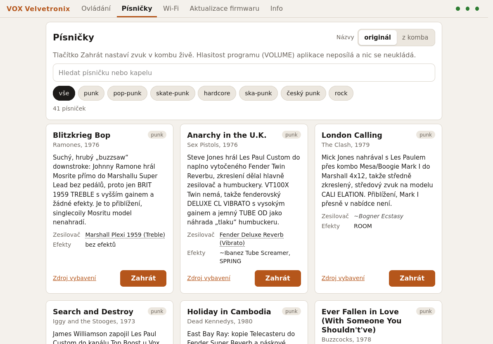
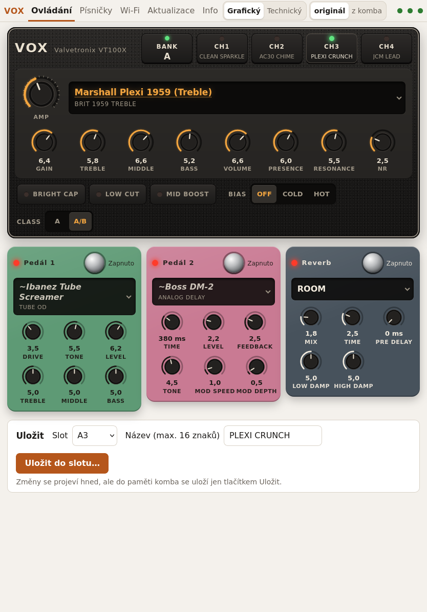
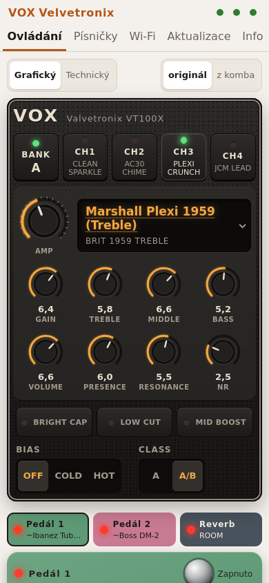

# pi-velvetronix

**English** · [Česky](README.cs.md)

Remote control for the **VOX Valvetronix VT100X** amp (VT-X series) from a tablet, phone or
computer over Wi-Fi. A small Raspberry Pi Zero 2 W is connected to the amp with a USB cable,
serves a web app (the interface is in Czech) and sends commands to the amp over USB-MIDI. It
works on the local network without internet and without the VOX Tone Room app.


## Features

- **The amp panel on screen.** Amp model, rotary knobs (GAIN, TREBLE, MIDDLE, BASS, VOLUME,
  PRESENCE, RESONANCE, NOISE REDUCTION), the BRIGHT CAP, LOW CUT, MID BOOST, BIAS and CLASS
  switches, banks and channels A1–B4. Pedals look like stompboxes with a footswitch, in the colour
  of the pedal they model.
- **Two views.** **Grafický** (graphic: the panel as on the amp) and **Technický** (technical:
  sliders and lists). A name switch **originál / z komba** (original / from the amp) shows e.g.
  "Marshall JCM800" instead of "BRIT 800". VOX does not officially name the originals of the pedals
  and some amps: uncertain names are marked "~" and underlined, sources are in `web/research/`.
- **Songs.** 41 approximate sounds of famous songs, mostly punk (punk, pop-punk, skate-punk,
  hardcore, ska-punk, Czech punk) and rock classics such as Seven Nation Army. **Zahrát** (play)
  sets the sound on the amp live only, does not change the program volume and saves nothing.
- **Tone Room presets (.vtxprog).** The **Tone Room** genre holds 59 community presets (Arctic
  Monkeys, Foo Fighters, Queen, QOTSA, Slipknot, The Strokes…) from the files of
  [marcosmoura/toneroom-presets](https://github.com/marcosmoura/toneroom-presets) (Beerware licence).
  Your own `.vtxprog` file from the VOX Tone Room app can be loaded with the **Nahrát soubor
  .vtxprog** button, and its programs played or saved to a channel.
- **Saving to channels.** A sound can be saved under its own name (up to 16 characters) to A1–B4.
  The amp confirms the write and the app verifies it by reading the slot back.
- **Several controllers at once, all live.** Up to 8 windows can control the amp at the same time:
  a tablet, a phone, another tab, or Claude through the MCP endpoint `/mcp`. Every window sees at once
  what the others changed, and what was turned on the amp itself.
- **Home-screen app on the iPad.** In Safari, Share → Add to Home Screen: its own icon, full screen
  without the Safari bars (see [Add to the home screen](#add-to-the-home-screen-of-an-ipad-or-phone)).
- **Tablet and phone layouts.** On an 11" iPad the whole panel with the pedals fits on one screen,
  in landscape and in portrait. On a phone the header is short (name, status dots, tabs) and the
  pedals are switched with the Pedál 1 / Pedál 2 / Reverb tabs, which also show whether each pedal
  is on and its effect type.
- **The amp's memory stays untouched until you say so.** The Pi blocks writes to the amp's memory
  (`4C`, `11`) unless the message is marked as an explicit save. Start-up, connecting and updates
  never overwrite anything.
- Wi-Fi settings, a fallback hotspot `VOX-Velvetronix`, firmware updates over the web with a
  return to the previous version if the new one does not start.

Power Level is an analogue control on the amp and cannot be set remotely.

| Technical view | Songs |
|---|---|
|  |  |

| iPad in portrait | Phone |
|---|---|
|  |  |

The screenshots come from the preview with a simulated amp (`cd web && npm run preview`).

## How it works

```
tablet / phone / Claude ──Wi-Fi── Pi Zero 2 W ──USB (OTG)── VOX VT100X
  web + VOX protocol            Go daemon:                  sound, programs
  (TypeScript)                  WebSocket ↔ ALSA rawmidi, MCP
                                command queue, forwarding,
                                login, Wi-Fi, mDNS,
                                updates with rollback
```

- The VOX protocol runs in the browser (`web/src/protocol/`). The Pi passes whole SysEx messages
  through and checks them. For the MCP endpoint the daemon has a Go port of the protocol
  (`internal/voxproto/`), tested against vectors generated from the TypeScript code.
- Every window is connected to the Pi through the WebSocket `/ws`. The daemon sends the commands
  from all windows to the amp one at a time and returns each reply to its sender, because the amp
  only answers "OK" and does not say to whom. Once the amp confirms a change, the daemon forwards
  it to the other windows. Changes made with the knobs on the amp go to all windows.
- Background: the protocol in [docs/protocol.md](docs/protocol.md) (from the official "Valvetronix X
  MIDI Implementation v1.0" and the [vox-amp-librarian](https://github.com/tmarsteel/vox-amp-librarian)
  project, MIT licence, Copyright (c) 2023 Tobias Marstaller), the design and interfaces in
  [docs/design.md](docs/design.md), the test log in [docs/testing.md](docs/testing.md).

## Add to the home screen of an iPad or phone

1. Open `http://velvetronix.local` in Safari and log in.
2. Tap **Share** → **Add to Home Screen** → **Add**.
3. A **VOX** icon appears on the home screen. It opens the app full screen.

The home-screen app has its own login, separate from Safari, so log in once more there. The login
lasts 30 days. The app does not work without a connection to the Pi: the web runs over HTTP on the
local network, where browsers do not allow an offline mode (service worker).

## MCP endpoint for Claude

The Pi serves an MCP endpoint at `http://velvetronix.local/mcp` through which Claude (or another
MCP client) can read and set the amp: status, live sound, songs and Tone Room presets, `.vtxprog`
files, selecting and saving programs. Open pages see its changes live. Only `vox_save_program`
writes to the amp's memory; everything else changes the live sound.

1. Get a token (it replaces the previous one and is shown only once):

   ```sh
   curl -s -c /tmp/vox -H 'Content-Type: application/json' \
     -d '{"password":"<web password>"}' http://velvetronix.local/api/login
   curl -s -b /tmp/vox -X POST http://velvetronix.local/api/mcp/token; rm /tmp/vox
   ```

2. Register it, e.g. in Claude Code:

   ```sh
   claude mcp add --scope user --transport http velvetronix http://velvetronix.local/mcp \
     --header "Authorization: Bearer <token>"
   ```

Changing the web password revokes the token. Details: [docs/design.md §7.1](docs/design.md).

From outside the local network (claude.ai connectors, the Claude apps) the endpoint is reachable
through a Cloudflare Tunnel as `https://vox.kaln.cz/mcp/<token>`: the token is in the path because
claude.ai connectors cannot send headers. Only `/mcp/<token>` is exposed. Setup:
[deploy/tunnel/README.md](deploy/tunnel/README.md).

## Hardware and wiring

| Part | Note |
|---|---|
| Raspberry Pi Zero 2 W | verified: `Raspberry Pi Zero 2 W Rev 1.0`, Raspberry Pi OS Lite 64-bit (Debian 13 trixie), kernel 6.18 |
| 5.1 V / 2.5 A power supply with micro-USB | the official Raspberry Pi supply (e.g. Alza `RKpi3na125`). Into the **PWR IN** port |
| OTG adapter micro-USB (male) → USB-A (female) | e.g. Alza `ugre27`, the official "Raspberry Pi Zero USB adapter" |
| Cable USB-A → the amp's connector | According to the Japanese manual, the panel drawing and the VOX website, the VT100X has a **USB mini-B** socket (the English manual says "Type B"). **Check the socket on the top panel before buying.** Short (0.5–1 m), shielded |

Ports on the Pi Zero 2 W (looking at the board, mini-HDMI on the left):

- **USB** (the middle micro-USB, closer to the mini-HDMI) = data, host for the amp. The OTG adapter
  goes here.
- **PWR IN** (the outer micro-USB in the corner) = power only. The power supply goes here.

```
5 V supply ──micro-USB──> [PWR IN]  Pi Zero 2 W  [USB] ──OTG adapter──> USB-A ──cable──> VOX (mini-B)
```

Power and VBUS:

- The Pi is **always powered by its own supply**. The amp does not power the Pi and must not.
- In host mode the Pi puts 5 V from its supply rail on the data port's VBUS (without a switch or
  fuse; the official schematic does not show it, community measurements confirm it). The amp is
  mains-powered and draws practically nothing from USB.
- Back-feeding: a USB device must not drive VBUS. You can check it once with a multimeter: amp on,
  Pi disconnected, there should be ~0 V between VBUS and GND on the cable from the amp.
- Do not connect the Pi's data port to a computer while a supply is plugged into PWR IN (two 5 V
  supplies against each other).
- The default USB driver `dwc_otg` switches to host mode based on the OTG adapter's ID pin. If the
  cable does not ground the ID pin, add `dtoverlay=dwc2,dr_mode=host` to
  `/boot/firmware/config.txt` and reboot.

Hum: the amp is a class I device (protective earth). The USB cable joins the Pi's ground to the
amp's ground. A short shielded cable, a good power supply on the same power strip as the amp and a
ferrite ring at the amp help. Keep the Pi and its antenna away from the INPUT jack and the guitar
cable.

## Placement

The VT100X has a closed bass-reflex cabinet, the electronics (mains supply, DSP, 100 W power amp,
tube) in the top chassis with vents in the rear plate, and the USB socket on the top panel.

- **Recommended: the Pi in a small vented plastic box on the outside of the cabinet's back or side
  wall**, in the lower half, attached with removable hook-and-loop tape (no screws into the
  cabinet). A metal box would dampen the Wi-Fi.
- At least ~10 cm from the chassis' rear plate and its vents; do not lean anything against the vents.
- Run the cable to the top USB socket over the top rear edge, away from the INPUT jack and the
  mains cable. Relieve strain on the micro-USB plug at the Pi (angled plug, clip): the cabinet
  vibrates.
- Inside the cabinet only if the back panel comes off with screws, and only in the speaker
  compartment, on the floor or the lower side wall, away from the chassis, the speaker, its magnet
  and the bass-reflex port, on foam pads against rattling. Unplug the amp from the mains first.
  Routing the cables needs a hole with a grommet (a change to the cabinet, warranty risk). Check the
  Wi-Fi signal before closing it.
- **Never touch the mains, tube or power amp sections, and never power the Pi from the amp's
  internal supply.** Such a change must be judged by a service technician with the schematic.
- The Pi Zero 2 W throttles from 80 °C. In open air it runs around 43 °C. Check the temperature with
  `vcgencmd measure_temp`.

## Addresses and credentials

| What | Value |
|---|---|
| Web (home network) | `http://velvetronix.local/`, `http://vox.local/`, or the IP address (shown on the Info tab) |
| Web (hotspot) | Wi-Fi `VOX-Velvetronix`, then `http://10.42.0.1/` |
| Web password | `WEB_PASSWORD` in `secrets/velvetronix.env` on the build machine (generated by the installer, not in Git) |
| Hotspot password | `AP_PSK` in the same file |
| SSH | `ssh velvetronix@velvetronix.local` (key from the build machine) |

The Pi Zero 2 W supports **2.4 GHz** Wi-Fi only.

## Building

On a Mac (Apple Silicon), you need Go (it fetches version 1.26.9 by itself from `go.mod`), Node 24
and npm. Dependencies are pinned in `go.mod`/`go.sum` and `web/package-lock.json`.

```sh
scripts/test.sh                    # web tests + build, go vet, go test, cross build
scripts/build.sh                   # web -> internal/web/dist/, Go -> dist/ (linux/arm64, static)
scripts/release.sh                 # dist/*.tar.gz, deterministic
scripts/test-deploy.sh             # tests of the install scripts in a Debian container (docker)
(cd web && npm run preview)        # preview of the UI in a browser with a simulated amp (no hardware)
(cd web && node scripts/vtx-presets.mjs)   # regenerate the Tone Room presets from web/research/vtxprog/
```

The version is in the `VERSION` file (or the variable `VERSION=0.2.0`). Outputs:

| File | Use |
|---|---|
| `dist/pi-velvetronix-<ver>-linux-arm64.tar.gz` | **update over the web** (only `manifest.json` + the binary) |
| `dist/pi-velvetronix-install-<ver>.tar.gz` | **first install / reinstall over SSH** (binary, systemd units, root scripts, polkit) |

## First install

1. Raspberry Pi Imager: Raspberry Pi OS Lite (64-bit), hostname `velvetronix`, user `velvetronix`,
   the home Wi-Fi (2.4 GHz), your country, SSH enabled. Insert the card and power on the Pi.
2. Upload your SSH key once: `ssh-copy-id velvetronix@velvetronix.local`.
3. `scripts/install.sh` (default target `velvetronix@velvetronix.local`). The script:
   - generates `secrets/velvetronix.env` if missing (mode 600, not in Git),
   - builds and packs a release, copies it to the Pi and runs `deploy/install-remote.sh` as root,
   - sends the secrets only through SSH stdin, never on a command line or into a log,
   - creates the system user `pi-velvetronix`, systemd units, the polkit rule, the `vox-ap`
     hotspot and zram swap, and disables PipeWire (a headless device; it could grab the MIDI port).
4. Open `http://velvetronix.local/` and log in with `WEB_PASSWORD`.

The install can be repeated at any time (it is idempotent); it keeps the Wi-Fi networks and secrets.

## Wi-Fi

- The Pi connects to the saved home networks (NetworkManager, retrying forever).
- When no home network is available for more than 90 s, the `VOX-Velvetronix` hotspot starts
  (WPA2, `10.42.0.1`). In hotspot mode the Pi keeps looking for saved networks and returns as soon
  as it sees one and nobody has used the hotspot for 5 minutes.
- The **Wi-Fi** tab: list of networks, connecting to a new network (SSID + password), forgetting a
  saved network, starting the hotspot by hand for N minutes.
- A failed connection never deletes a saved configuration. Only the Forget button deletes.

## Firmware updates (over the web)

1. `VERSION=0.2.0 scripts/build.sh && VERSION=0.2.0 scripts/release.sh`
2. Web → **Aktualizace firmwaru** (firmware update) → pick
   `dist/pi-velvetronix-0.2.0-linux-arm64.tar.gz` → upload. (Or from the build machine:
   `scripts/dev-update.sh velvetronix.local dist/...tar.gz`.)
3. The daemon checks the package (gzip, a tar with two files, name, architecture `linux/arm64`,
   version, sha256, ELF aarch64, at most 40 MiB) and rejects anything else, such as an SD card image
   (`.img`, `.xz`), a zip, a bare binary or a package for another architecture.
4. Control commands are paused during the install. The root updater checks the package again,
   installs it into `/opt/pi-velvetronix/releases/<ver>/`, atomically switches the `current`
   symlink and restarts the service. The web shows progress and the result and reconnects by itself.
5. The new version is confirmed only after its own check (HTTP on `127.0.0.1`), independent of the
   amp and the home Wi-Fi. If it fails to confirm three times (crash, hang, 60 s timeout),
   `boot-guard` returns to the previous version. The result is shown on the update page.

The web update replaces only the application (and the web UI built into the binary). Systemd units,
root scripts and polkit change only with `scripts/install.sh`. Every new version must stay
compatible with the installed root scripts; otherwise deploy it with `scripts/install.sh`.

## Recovery

| Situation | What to do |
|---|---|
| Web down, SSH works | `scripts/install.sh` reinstalls the current version |
| Home network unavailable | join the `VOX-Velvetronix` hotspot, open `http://10.42.0.1/`, set up Wi-Fi |
| Nothing works | take out the microSD card, flash the system again with Raspberry Pi Imager and do the "First install". The Pi Zero has no BOOT/RESET buttons; recovery is always through the SD card |
| Forgotten web password | `scripts/install.sh` sets the password from `secrets/velvetronix.env` again (or delete the file and a new one is generated) |

Logs: `ssh velvetronix@velvetronix.local sudo journalctl -u pi-velvetronix -u pi-velvetronix-updater -b`.
Passwords, PSKs and session tokens are never logged.

## Testing with the amp

The VT100X has been verified (see [docs/testing.md](docs/testing.md)). If the Pi does not find it:

1. Wire the Pi as shown above and power on the amp.
2. Web: the status dot for **Kombo (USB)** should be green (only after the amp answers the Device
   Inquiry). Without the amp it reports "odpojeno" (disconnected).
3. Check on the Pi (the service holds the MIDI port exclusively, so stop it for a moment):

   ```sh
   ssh velvetronix@velvetronix.local
   lsusb                                    # expect 0944:xxxx (KORG)
   cat /proc/asound/cards; amidi -l         # name "Valvetronix X" or similar
   sudo systemctl stop pi-velvetronix
   amidi -p hw:1,0,0 -S "F0 7E 7F 06 01 F7" -d -t 2        # identity, expect ... 42 34 01 ...
   amidi -p hw:1,0,0 -S "F0 42 30 00 01 34 12 F7" -d -t 2  # mode, expect F0 42 30 00 01 34 42 ...
   sudo systemctl start pi-velvetronix
   ```

4. If the card has a different name and the web reports "odpojeno", send the output of
   `cat /proc/asound/cards`. The device is chosen by the `--midi-match` flag (default `Valvetronix`).

## Limitations

- With a real VT100X, connecting, control, saving to a slot with read-back and shared control from
  several windows are verified. Whether saved programs survive switching the amp off, and changes
  made with the knobs on the amp itself, are not verified yet. See [docs/testing.md](docs/testing.md).
- `.vtxprog` files can be loaded and played; exporting to `.vtxprog` is not available yet.
- The web runs over HTTP on the local network; the password travels unencrypted.
- The polkit rule allows NetworkManager actions for the user `pi-velvetronix` (a check by systemd
  unit does not work on polkitd 126).

## Licence

[MIT](LICENSE). The protocol description and tables are based on the official VOX "Valvetronix X
MIDI Implementation v1.0" and on the [vox-amp-librarian](https://github.com/tmarsteel/vox-amp-librarian)
project (MIT, Copyright (c) 2023 Tobias Marstaller); no code was taken from it. The Tone Room
presets in `web/research/vtxprog/marcosmoura/` are by Marcos Moura under the Beerware licence (see
the `LICENSE` file there). VOX, Valvetronix and the names of the modelled amps and effects are
trademarks of their owners and are used only to identify sounds. The project is not affiliated
with VOX Amplification or KORG.
